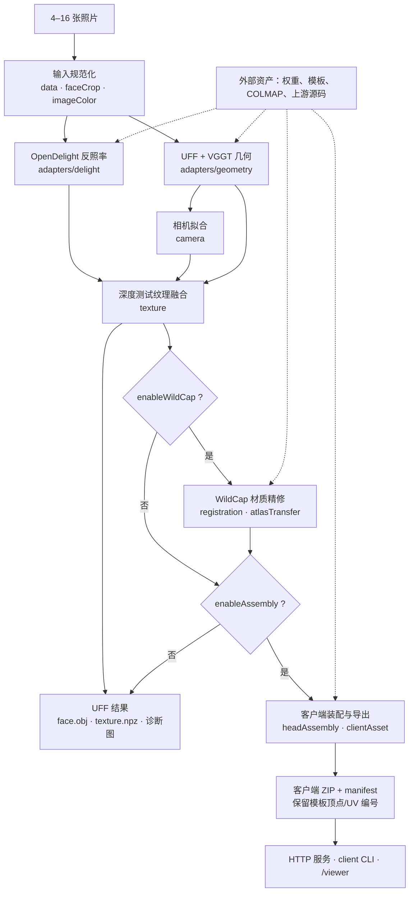
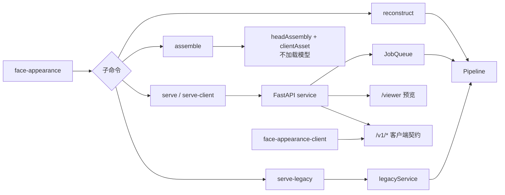

# 项目地图

本文件是 `dsh-test`（FaceAppearance 原型）的代码地图：说明项目做什么、一次任务怎样从照片走到客户端资产、代码分布在哪里，以及阅读和修改时先看哪些文件。环境安装、外部权重和部署步骤见 [源码与部署说明](sourceSetup.md)。

## 1. 项目一句话

从 4–16 张同一人的不同角度照片，重建 UVFaceFusion 规范拓扑（`uvFaceFusionCanonical6986`）的人脸几何与可重打光材质，再装配成保留旧客户端模板顶点编号、UV 与绑定拓扑的 ZIP 资产；同时提供 CLI、HTTP 服务、旧协议服务和网页预览。

仓库只提交源码、配置、测试、文档和部署模板。模型权重、照片、客户端模板、配准资产与运行结果都在外部准备；缺失时服务无法完成真实重建，也不能把 CPU 单元测试通过当作重建效果验收。

## 2. 一张图看懂数据流



`stopAfter` 决定任务在哪一步停止：

| `stopAfter` | 实际执行的阶段 | 典型用途 |
|---|---|---|
| `geometry` | 输入规范化 → 几何 | 快速检查拓扑、相机和裁剪 |
| `delight` | 几何 → 反照率 | 检查去光结果 |
| `fusion`（默认） | 几何 → 反照率 → 相机与纹理融合 | 生成 UFF 网格和可查看的贴图 |
| `wildcap` | 以上 → WildCap 材质精修 | 实验性漫反射/高光/法线改进 |
| `assembly` | 以上（可选 WildCap）→ 客户端装配 | 产出可交付的客户端 ZIP |

## 3. 运行入口



| 入口 | 代码 | 作用 |
|---|---|---|
| `face-appearance reconstruct` | `cli.py` → `pipeline.py` | 本地重建，按 `stopAfter` 输出中间结果 |
| `face-appearance assemble` | `cli.py` → `headAssembly.py` / `clientAsset.py` | 用已保存的 `geometry.npz` + `texture.npz` 离线装配，不加载模型 |
| `face-appearance serve` | `service.py` | 通用 FastAPI 任务接口；是否可交付客户端资产由配置决定 |
| `face-appearance serve-client` | `service.py` + `clientService.py` | 要求 `enableAssembly=true`，提供 `/v1/*` 客户端契约与 `/viewer` |
| `face-appearance serve-legacy` | `legacyService.py` | 旧 notebook JSON/URL 协议，兼容已部署客户端 |
| `face-appearance-client` | `clientCli.py` | 提交、续跑、离线检查客户端 ZIP；从不初始化重建模型 |

## 4. 一次重建的产物

`Pipeline.run` 在输出目录中按阶段落盘：

```text
runs/<run>/
├── inputs.json / config.json
├── input00.png … inputNN.png          # 规范化后的输入
├── geometry.npz                       # 顶点、面、UV、相机外参等数组
├── face.obj / face.mtl                # UFF 规范网格；OBJ 的 vt 已翻转 V
├── viewTransforms.json                # world → canonical 变换
├── delight.npz / delight00.png / delightMask00.png
├── cameras.json / camera00.png …      # 每视角相机和重投影诊断
├── texture.npz / albedo.png / albedoPreview.png
├── coverage.png / confidence.png
├── wildcapIct/ / wildcapUff/          # 可选：WildCap 精修与回传
├── assembly/                          # 可选：客户端装配包
│   ├── clientMesh.npz / textures/
│   ├── manifest.json / archive.json
│   └── clientAsset.zip
└── result.json                        # 状态、耗时与诊断
```

公开接口的整体流程在 `pipeline.py`；每个阶段都尽量保持可独立调用，实验脚本可以直接复用已保存的数组，而不必重跑整条链。

## 5. 仓库目录

```text
dsh-test/
├── README.md                  # 项目介绍、目录与最小运行说明
├── pyproject.toml             # 包定义、两个 CLI 入口、pytest 配置
├── requirements.runtime.txt   # 原型增量依赖
├── configs/                   # 10 个可读 JSON 管线配置
├── deploy/                    # 环境模板、systemd unit、旧服务启动脚本
├── docs/                      # 项目地图与本机/外部依赖说明
├── src/faceAppearance/        # 主体源码，约 130 个 Python 文件
│   ├── cli.py / clientCli.py  # 两个命令行入口
│   ├── pipeline.py            # 重建阶段编排
│   ├── adapters/              # UFF、OpenDelight、FACER、STFR、Pixel3DMM、WildCap 适配器
│   ├── vendor/                # 随源码提交的 UFF / WildCap 片段
│   ├── web/                   # 客户端资产 Three.js 预览
│   ├── *Web/                  # 8 个实验对比预览页
│   └── *.py                   # 输入、几何、纹理、装配、服务和实验模块
├── tests/                     # 123 个测试文件，含 Display P3 色彩配置 fixture
└── tools/                     # 247 个资产准备、实验、渲染、诊断和验证脚本
```

| 目录 | 看什么 |
|---|---|
| `src/faceAppearance/` | 所有运行时能力；以 `cli.py`、`pipeline.py`、`headAssembly.py` 为主干 |
| `tests/` | 模块契约和回归；文件名与源模块基本一一对应 |
| `configs/` | 选一条处理链；字段默认值见 `config.py` 的 `PipelineConfig` |
| `tools/` | 历史实验与资产流水线；不等于开箱即用的服务步骤，先读脚本头注释 |
| `deploy/` | 环境、systemd 与启动脚本模板，路径需按实际部署修改 |
| `docs/` | 本文件与 `sourceSetup.md`（安装、权重、模板、COLMAP、部署） |

## 6. 模块地图

### 主干

| 模块 | 职责 |
|---|---|
| `cli.py` | 薄命令行：解析参数、选配置、调用 `Pipeline` 或服务 |
| `pipeline.py` | 模型加载与阶段编排；`loadModels`、`run`、`finishFusion`、`refineMaterials`、`assembleAsset` |
| `config.py` | `PipelineConfig` 的唯一字段定义与校验；配置中的未知字段会直接报错 |
| `service.py` | FastAPI 应用、上传校验、Bearer 鉴权、模型预热和任务队列接线 |
| `jobs.py` | 单消费者 `JobQueue`、目录锁、任务持久化与产物白名单 |
| `clientService.py` | `/v1/capabilities`、`/v1/jobs`、状态、下载与 manifest 契约 |
| `legacyService.py` | 旧 `/generate/`、`/task/status/`、`/tasks/*` 协议、OSS 上传和回调 |
| `webPreview.py` | `/viewer` 与客户端预览路由；从已验证 ZIP 生成预览，不重新推断 rig |

### 输入与预处理

`data.py`（严格读图、EXIF/ICC、内容哈希）、`imageColor.py`（sRGB 色彩管理）、`faceCrop.py`（`centerSquare` / `faceSquare`）、`faceSelection.py`（确定性选脸）、`faceSemantics.py`（原始图像坐标语义）、`runtime.py`（离线上游路径与下载开关）。

### 几何、相机与配准

`adapters/geometry.py`（UFF/VGGT 几何，模型生命周期由适配器独占）、`vendor/uvFusion/`（随源码提交的 UFF 片段）、`camera.py`（规范空间 PnP 与留出点校验）、`cameraPoseRefinement.py`、`cameraDiagnostics.py`、`photoCameras.py`、`correspondence.py`（最近三角形对应）、`registration.py`（版本化配准资产与 atlas 映射）、`surfaceSampling.py`、`surfaceVisibility.py`。

### 反照率、光照与材质

`adapters/delight.py`（OpenDelight 去光）、`photoLighting.py`、`shDelight.py`、`appearanceObservations.py`、`normalTransfer.py`、`adapters/wildcap.py` + `vendor/wildCap/`（ICT 材质精修）、`atlasTransfer.py`（跨 atlas 的掩码重采样）、`renderMaterials.py`。

### 纹理与融合

`texture.py`（UV 查找、深度测试投影、保守反照率融合）、`frequencyFusion.py`、`semanticFusion.py`、`observedSampling.py`、`uvAlignment.py`、`skinExtrapolation.py`。

### 客户端装配与导出

`headAssembly.py`（把重建脸重定向到固定客户端网格）、`clientAsset.py`（ZIP/manifest/材质导出）、`clientTemplate.py`（只读模板拓扑）、`clientImport.py`（不解压读取客户端 ZIP）、`clientContract.py`（交付前校验）、`clientTextureBaking.py`、`clientTextureBoundary.py`、`clientUvLookupCache.py`、`clientReferenceView.py`。

### 客户端几何/外观精修（多为实验路径）

`clientGeometryRefinement.py`、`directTemplateRegistration.py`、`directClientService.py`、`colmapTexture.py`、`renderedJaw*.py`、`adaptiveChinRefinement.py`、`clientChinRefinement.py`、`clientLipTrace.py`、`clientResidualEyeRefinement.py`、`clientVisibleEyeRefinement.py`、`clientEyelidAppearance.py`、`clientShDelight.py`、`clientShTemplateBlend.py`、`eyeAccessoryFollowing.py`。这些能力由配置开关选择，默认不全部启用。

### 旧客户端兼容

`legacyService.py`、`legacyPreview.py`、`legacyPreviewAsset.py`、`legacyTransport.py`、`legacyAsset.py`、`legacyBarycentric.py`、`legacyUvCorrection.py`、`legacyAppearanceVariant.py`、`legacyGeometryVariant.py`、`integrationRelay.py`。`legacyWeb/` 是对应的旧资产预览页。

### 通用几何工具与约束

`geometryRefinement.py`、`fixedBoundaryDeformation.py`、`barycentricDeformation.py`、`localSurfaceRegistration.py`、`localContourRefinement.py`、`guardedMeshQuadratic.py`、`meshShapeConstraints.py`、`supportedShapeConstraints.py`、`surfaceFairing.py`、`surfaceContactConstraints.py`、`cavityPrior.py`、`unsupportedCavityPrior.py`、`unsupportedShapePrior.py`、`anatomicalBoundaries.py`。

### 按前缀导航

| 前缀/目录 | 通常表示 |
|---|---|
| `client*` | 客户端模板、装配、纹理烘焙或客户端表面精修 |
| `eye*` / `eyelid*` / `visibleEye*` | 眼睛和眼睑的对应、观测与拟合 |
| `brow*` / `nose*` / `chin*` / `jaw*` / `renderedJaw*` | 五官或下颌的局部几何/纹理实验 |
| `render*` | 渲染、材质准备或对比图生成 |
| `camera*` / `photo*` | 相机求解、照片坐标或光照观测 |
| `surface*` / `mesh*` / `normal*` / `registration*` | 表面采样、约束、法线与配准 |
| `legacy*` | 旧服务协议、旧 ZIP 变体或旧预览 |
| `*Web/` | 只在预览中使用的静态页面，由 `tools/serve*.py` 或 `legacyPreview.py` 挂载 |
| `adapters/` | 外部模型适配的主要边界层 |
| `vendor/` | 随仓库提交的最小上游片段，许可证与来源见各自目录 |

## 7. 配置地图

| 配置 | 用途 |
|---|---|
| `preview512.json` | 512 分辨率快速预览，不装配、不启用 WildCap |
| `quality1024.json` | 1024 分辨率质量路径，不装配、不启用 WildCap |
| `centerCropControl.json` | 用 `centerSquare` 代替 `faceSquare` 的对照配置 |
| `clientAssetPrototype.json` | 客户端装配原型，从 fusion 结果装配到女性旧模板 |
| `clientService.json` | 客户端服务默认配置：1024、`faceSquare`、从 fusion 装配 |
| `clientLegacyBarycentric.json` | 旧模板的重心坐标变体 |
| `clientLegacyBarycentricUv.json` | 旧模板的重心坐标 + UV 变体 |
| `stableLegacyService.json` | 旧协议服务：男性走 directColmap + rendered jaw，女性走 UV transfer |
| `localWarmLegacyService.json` | 同上，另带默认关闭的四图启动预热示例 |
| `wildCapPrototype.json` | 启用 WildCap（512、599 次迭代）的材质实验配置 |

所有配置的 `projectRoot` 都是相对路径；`PipelineConfig.fromFile` 会把它解析为仓库根目录。配置中的开关决定实际处理链，实验模块存在不代表默认启用。

## 8. 服务与任务模型

- `serve` / `serve-client`：一个 ASGI 进程对应一块 GPU；模型在启动时加载，作业串行执行。两者共用 `/v1/capabilities`、`/v1/jobs`、`/v1/jobs/{id}`、`/download`、`/manifest` 和 `/viewer`；`serve-client` 额外强制 `enableAssembly=true`，未装配时 `/v1/jobs` 返回服务不可用。
- `serve-legacy`：兼容旧 JSON/URL 协议；性别决定使用哪套预加载模板，不会静默改变模板。支持 OSS 结果上传与 `notify_url` 回调。
- `JobQueue`：一个 `outputRoot` 只允许一个消费者；启动时取得 `.service.lock`，任务记录持久化为 `job.json`，重启时未完成任务显式失败而不是重放。
- 上传限制：单图 25 MiB、总计 200 MiB；去重、数量范围和图片解码在入队前校验。
- 可选 Bearer token 由环境变量（默认 `FACE_APPEARANCE_API_TOKEN`）提供；`/viewer` 静态壳公开，便于输入 token。
- 服务交付的资产带有 `client_rig_not_validated`、`appearance_not_physically_calibrated`、`unobserved_regions_use_template` 等告警；这不是完整 rig 或物理 PBR 验收。

## 9. 外部资产与关键约定

外部目录契约（详见 [sourceSetup.md](sourceSetup.md)）：`01_UVFaceFusion/`、`02_OpenDelight/`、`03_WildCap/`、`04_STFR/`、`thirdParty/`、`assets/`，以及独立的 COLMAP 环境。权重和模板不会在请求中自动下载。

阅读代码时最容易踩错的约定：

- **数组 UV**：u 向右、v 向下；整数像素中心 `(x, y)` 对应 `(x/(W-1), y/(H-1))`。导出 OBJ 时只翻转一次 V。
- **几何单位**：UFF 规范空间单位未标定；客户端模板使用厘米，导出 `clientMesh.npz` 时统一转米。
- **颜色**：OpenDelight 输出保留原生 RGB，不声明为物理标定线性反照率；WildCap 漫反射按上游 gamma-2.2 约定处理。客户端材质声明为 sRGB，alpha 为线性覆盖。
- **拓扑**：客户端模板的顶点编号、面顺序、UV 和绑定是硬契约；装配和导出不做焊接、重排或重新三角化。
- **法线**：源切线/法线约定尚未认证，WildCap 法线回传状态是 `blockedOnSourceConventionVerification`，不要把它当已验证 PBR 法线。
- **上游边界**：第三方路径由 `runtime.configureRuntime` 注入；大部分模型生命周期集中在 `adapters/`，少数显式运行时模块（如 `renderedJawRuntime.py`）会自行加载本地 FAN。随源码提交的上游片段只在 `vendor/`，并保留许可证。

## 10. 测试与工具地图

- `tests/` 有 123 个测试文件，命名对应源模块。README 给出的子集不依赖模型和资产；完整目录包含真实模板、上游模型和历史实验验证，缺少外部文件时会失败。
- `tools/` 有 247 个脚本，按前缀大致分为：
  - `prepare*`：模板、配准、纹理等资产准备；
  - `cache*`：语义、眼睑、先验等离线缓存；
  - `run*` / `experiment*`：可复现实验入口；
  - `render*`：对比渲染与证据图生成；
  - `serve*`：实验结果的只读本地预览；
  - `audit*` / `diagnose*` / `inspect*` / `verify*`：只读诊断与审计；
  - `validate*` / `summarize*` / `evaluate*` / `build*`：验收、汇总和产物构建。
- 工具脚本不是服务 API 的一部分；运行前先看文件头说明、所需 `runs/`、`reports/` 或本地数据。

## 11. 建议的阅读/修改路径

1. 想了解全局：本文件 → `README.md` → `docs/sourceSetup.md`。
2. 想改重建流程：`pipeline.py` → `config.py` → 对应阶段模块（`adapters/*`、`camera.py`、`texture.py`）。
3. 想改客户端交付：`headAssembly.py` → `clientAsset.py` → `clientContract.py` → `clientService.py`。
4. 想改服务/队列：`service.py` → `jobs.py` → `clientService.py` 或 `legacyService.py`。
5. 想追某个实验：按 `tools/<experiment>.py` 的导入和输出路径回到具体模块；不要从 `tools/` 反推默认服务行为。
